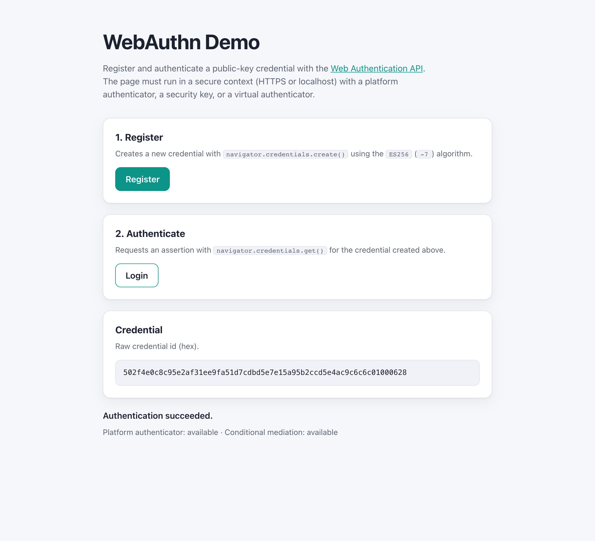

# WebSharper.WebAuthentication

[](https://github.com/dotnet-websharper/WebAuthentication)

WebSharper bindings for the [Web Authentication API](https://developer.mozilla.org/en-US/docs/Web/API/Web_Authentication_API)
(WebAuthn) — passwordless, public-key authentication from F# and C# web apps.

WebAuthn is only available in [secure contexts](https://developer.mozilla.org/en-US/docs/Web/Security/Defenses/Secure_Contexts)
(HTTPS or localhost), and the browser needs a platform authenticator (Touch ID,
Windows Hello, …), a roaming security key, or a virtual authenticator.

This repository contains:

| Project | Purpose |
| --- | --- |
| `WebSharper.WebAuthentication` | The binding: WIG definitions for `PublicKeyCredential`, the creation/request option dictionaries, the authenticator response types, and the WebAuthn enums. |
| `WebSharper.WebAuthentication.Extensions` | `[<Inline>]` client extensions: `Navigator.Credentials`. |
| `WebSharper.WebAuthentication.Sample` | An ASP.NET Core SPA that registers and authenticates a public-key credential. |

## Live demos

**Try it live:** [Open the sample in your browser](https://dotnet-websharper.github.io/WebAuthentication/)



The sample doubles as the binding's [test case](#running-the-sample): it registers and authenticates a public-key credential in a real browser.

- **Sample (this repository):** <https://dotnet-websharper.github.io/WebAuthentication/>
- **Source repository:** <https://github.com/dotnet-websharper/WebAuthentication>
- **WebSharper bindings:** <https://websharper.com/bindings>

## Features

- `navigator.credentials.create()` and `navigator.credentials.get()` typed through
  `CredentialsContainer`, `CredentialCreationOptions`, and `CredentialRequestOptions`.
- The full creation/request option graph: `PublicKeyCredentialCreationOptions`,
  `PublicKeyCredentialRequestOptions`, `RpObject`, `UserInfo`, `PubKeyCredParamsObject`,
  `AllowCredentialsObject`, `ExcludeCredentialsObject`, and `AuthenticatorSelectionObject`.
- `PublicKeyCredential` with `id`, `rawId`, `type`, `authenticatorAttachment`, `response`,
  `getClientExtensionResults()`, and `toJSON()`; plus the static capability probes
  `isUserVerifyingPlatformAuthenticatorAvailable()` and `isConditionalMediationAvailable()`.
- The attestation/assertion response types (`AuthenticatorAttestationResponse`,
  `AuthenticatorAssertionResponse`, `AuthenticatorResponse`).
- The WebAuthn enumerations: `Attestation`, `AuthenticatorAttachment`, `ResidentKey`,
  `UserVerification`, `Transports` (including `smart-card`), `CredentialType`, `Hints`,
  and `Format`.

## Installation

The binding is not currently published to NuGet. Reference the projects from source:

```bash
git clone https://github.com/dotnet-websharper/WebAuthentication.git
```

```xml
<ItemGroup>
  <ProjectReference Include="path/to/WebSharper.WebAuthentication/WebSharper.WebAuthentication.fsproj" />
  <ProjectReference Include="path/to/WebSharper.WebAuthentication.Extensions/WebSharper.WebAuthentication.Extensions.fsproj" />
</ItemGroup>
```

## Usage

```fsharp
namespace WebSharper.WebAuthentication.Demo

open WebSharper
open WebSharper.JavaScript
open WebSharper.WebAuthentication

[<JavaScript>]
module Demo =
    let credentials = JS.Window.Navigator.Credentials

    // A random byte buffer. In a real app the challenge is generated and later
    // verified by the server.
    let randomBytes (n: int) =
        JS.Eval(sprintf "crypto.getRandomValues(new Uint8Array(%d)).buffer" n) |> As<ArrayBuffer>

    let register () =
        promise {
            let parameters =
                PubKeyCredParamsObject(
                    alg = -7,
                    ``type`` = CredentialType.Public_key
                )

            let creationOptions =
                PublicKeyCredentialCreationOptions(
                    challenge = randomBytes 32,
                    rp = RpObject(name = "My Demo App"),
                    user =
                        UserInfo(
                            id = randomBytes 16,
                            name = "user@example.com",
                            displayName = "Test User"
                        ),
                    pubKeyCredParams = [| parameters |]
                )

            creationOptions.Attestation <- Attestation.None

            let options = CredentialCreationOptions(publicKey = creationOptions)
            let! credential = credentials.Create(options)
            Console.Log("Registered credential:", credential.Id)
        }

    let login () =
        promise {
            let requestOptions = PublicKeyCredentialRequestOptions(challenge = randomBytes 32)
            requestOptions.AllowCredentials <-
                [|
                    AllowCredentialsObject(
                        id = randomBytes 16, // the stored credential id
                        ``type`` = CredentialType.Public_key
                    )
                |]

            let options = CredentialRequestOptions()
            options.PublicKey <- requestOptions

            let! assertion = credentials.Get(options)
            Console.Log("Authenticated:", assertion.Id)
        }

    let supported () =
        PublicKeyCredential.IsUserVerifyingPlatformAuthenticatorAvailable()
```

`navigator.credentials` is provided by `WebSharper.WebAuthentication.Extensions`
(`Navigator.Credentials`). The creation/request option types are
`Pattern.Config` dictionaries: required fields are constructor arguments, and
optional fields are settable properties (`options.Attestation <- ...`,
`options.AllowCredentials <- ...`).

## Running the sample

Build the sample in Release and serve its static output:

```bash
dotnet build WebSharper.WebAuthentication.Sample/WebSharper.WebAuthentication.Sample.fsproj -c Release
python3 -m http.server -d WebSharper.WebAuthentication.Sample/wwwroot 5215
```

Open <http://localhost:5215/>. Localhost counts as a secure context, so WebAuthn is
available. Click **Register**, then **Login**; the browser prompts for a platform
authenticator or security key. Without a physical authenticator you can add a
virtual authenticator from the browser's DevTools (WebAuthn tab) or via the Chrome
DevTools Protocol (`WebAuthn.enable` + `WebAuthn.addVirtualAuthenticator`).

Alternatively, run the ASP.NET Core host:

```bash
dotnet run --project WebSharper.WebAuthentication.Sample
```

## Building from source

### Prerequisites

- [.NET SDK 10](https://dotnet.microsoft.com/download) or later.

### Build

```bash
dotnet tool restore
dotnet paket install
dotnet build WebSharper.WebAuthentication.sln -c Release
```

The binding and Extensions projects target `netstandard2.0`; the sample targets
`net10.0`.

## Deployment

Pushing to `master` triggers `.github/workflows/ghpages.yml`, which builds the
sample in Release and publishes `WebSharper.WebAuthentication.Sample/wwwroot` to
the `gh-pages` branch.

## Repository layout

```
WebSharper.WebAuthentication/              # binding (WIG definitions)
  Main.fs
WebSharper.WebAuthentication.Extensions/   # [<Inline>] client extensions
  Library.fs
WebSharper.WebAuthentication.Sample/       # ASP.NET Core SPA demo
  Client.fs
  Startup.fs
  wwwroot/
    index.html
    site.css
.github/workflows/ghpages.yml              # build + deploy the sample to GitHub Pages
nuget/WebSharper.WebAuthentication.paket.template  # package metadata
```

## Notes on the API

- **Secure context:** `navigator.credentials` and `PublicKeyCredential` are only exposed
  in secure contexts. Serve the page over HTTPS or from localhost.
- **User gesture:** `create()` and `get()` require a user gesture (for example, a button
  click). Handle rejected promises when the user cancels the prompt.
- **Challenges:** the sample generates a random challenge in the browser for
  demonstration. In production the server must generate the challenge, store it with the
  user, and verify the returned signature.
- **Option dictionaries:** required fields are constructor arguments (using their
  lower-case JavaScript names, e.g. `challenge`, `rp`, `user`, `pubKeyCredParams`), while
  optional fields are PascalCase settable properties. Both map to the lower-case
  JavaScript object keys WebAuthn expects.
- **Response types:** `PublicKeyCredential.response` is typed as
  `AuthenticatorAttestationResponse + AuthenticatorAssertionResponse`; cast it to the one
  you expect. `AuthenticatorResponse.clientDataJSON` is an `ArrayBuffer`.
- **Capability probes:** use `PublicKeyCredential.IsUserVerifyingPlatformAuthenticatorAvailable()`
  and `PublicKeyCredential.IsConditionalMediationAvailable()` (both return
  `Promise<bool>`), and `CredentialsContainer.GetClientCapabilities()` for a newer,
  experimental capability dictionary.

## License

Apache 2.0 — see [LICENSE.md](LICENSE.md).
